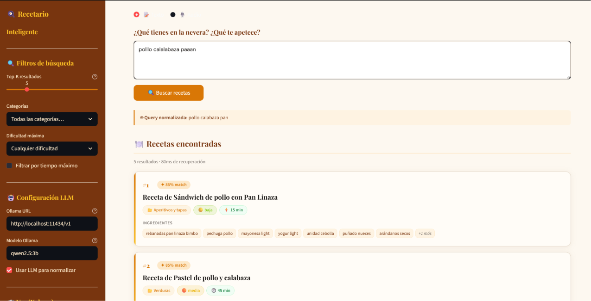

# Hola, soy David 👋
 
### Data Science + Cloud Computing
 
*Entiendo el negocio, diseño e integro la solución y la despliego.*
 

 

Proyectos guapos
 

<table align="center">
  <tr>
    <td width="50%" valign="top" align="center">
      <h3>🦥 Automatizando la automatización</h3>
      <b>Agente de IA con ojos y manos que convierte una explicación en un robot RPA determinista</b>
        
      
        
      

        Describes la tarea en lenguaje natural, el agente <b>mira la pantalla</b>, hace clics, rellena formularios,
        <b>verifica su propio trabajo</b> y se corrige. Al terminar, su ejecución se cristaliza en un
        <b>flujo RPA en JSON</b> que se repite en segundos, <b>sin IA</b>, auditable y siempre igual.
      

      

        
        
        
        
        
        
        
        
        
        
        
        
        
      

      <a href="https://github.com/DavidPPLAZA/AUTOMATIZACI-N-CON-RPA-AGENTE-MULTIMODAL-DE-VISI-N"><b>👉 Ver repositorio</b></a>
    </td>
    <td width="50%" valign="top" align="center">
      <h3>🍳 Recetario Inteligente</h3>
      <b>RAG multimodal con entrada y salida por voz</b>
        
      
        
      

        Pides una receta <b>hablando</b> ("tengo tomate, huevo y cebolla…") y el sistema transcribe, normaliza la
        consulta con un <b>LLM local</b>, busca por <b>similitud semántica</b> entre ~22.000 recetas y te
        <b>responde con voz</b>. Incluye comparativa BM25 vs. embeddings, re-ranking y UMAP.
      

      

        
        
        
        
        
        
        
        
        
        
        
        
        
      

      <a href="https://github.com/DavidPPLAZA/Natural-Language-Processing-project"><b>👉 Ver repositorio</b></a>
    </td>
  </tr>
</table>
 
